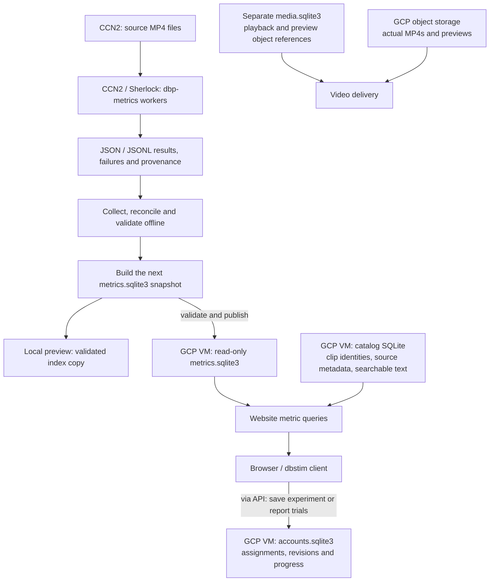
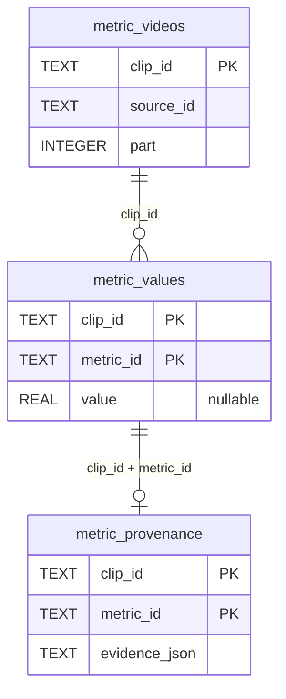

# Metric storage and filtering

**The live metric index is a SQLite file on the GCP website VM.** CCN2/Sherlock
compute measurements offline; the website does not query those clusters when
you move a filter.

## Where the data live



These are **different databases**, not replicas of one shared CCN2 database.
Cluster bookkeeping and raw results are not the website's serving index.
Scientific values become live through explicit publication, not automatic database
synchronization. Existing published assignments remain fixed.

The deployed scientific file is `/srv/dbp/metrics/metrics.sqlite3`; the local
preview uses `.local-data/metrics/metrics.sqlite3` in the operator workspace.
SQLite runs inside the website process; this is not a PostgreSQL/Cloud SQL service.
Video bytes live in object storage, not inside SQLite.

## Inside the scientific index



The diagram shows logical joins. One clip can have many measurements, but at most
one stored value per `(clip_id, metric_id)`. Provenance identifies the method,
media hash and sampling scope. Other tables hold computation policies, histogram
bins and catalog/version identity. Missing rows or null values mean **unknown**.

## What a filter does

```python
filters = [
    MetricFilter("duration_seconds", ">=", 10),
    MetricFilter("source_view_count", ">=", 100_000),
]
```

1. The API receives these comparisons, validates types/ranges/operators, and
   compiles parameterized SQL against stored values.
2. Each comparison selects matching clip IDs. The intersection (**AND**) must
   satisfy both; unknown values fail an active comparison. An unset threshold
   leaves that filter inactive.
3. A batched server-side aggregation recomputes metric distributions over matching
   **videos**, using the same bins as the full baseline. The browser receives
   aggregates and one results page—not the entire database.
4. Experiment creation samples from the eligible matching pool using the chosen
   seed/design/channel rules. Matching metadata alone does not guarantee playable
   media or assignment eligibility.

No FFmpeg/OCR/VLM computation runs during filtering. Source views describe the
original source video; its clips inherit that value. `client.metrics()` lists
metric definitions, not per-video measurements. Operators `>= <= > < ==` mean
`gte lte gt lt eq`.

Implementation: website `metric_registry.py`, `metric_explorer.py`,
`metric_artifact.py`; package `dbp_metrics` produces the worker results.

[API objects](api-classes.md) · [Media and session flow](server-to-local-flow.md)
