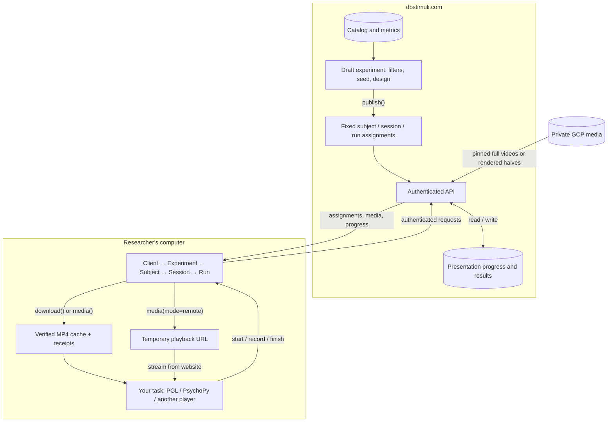
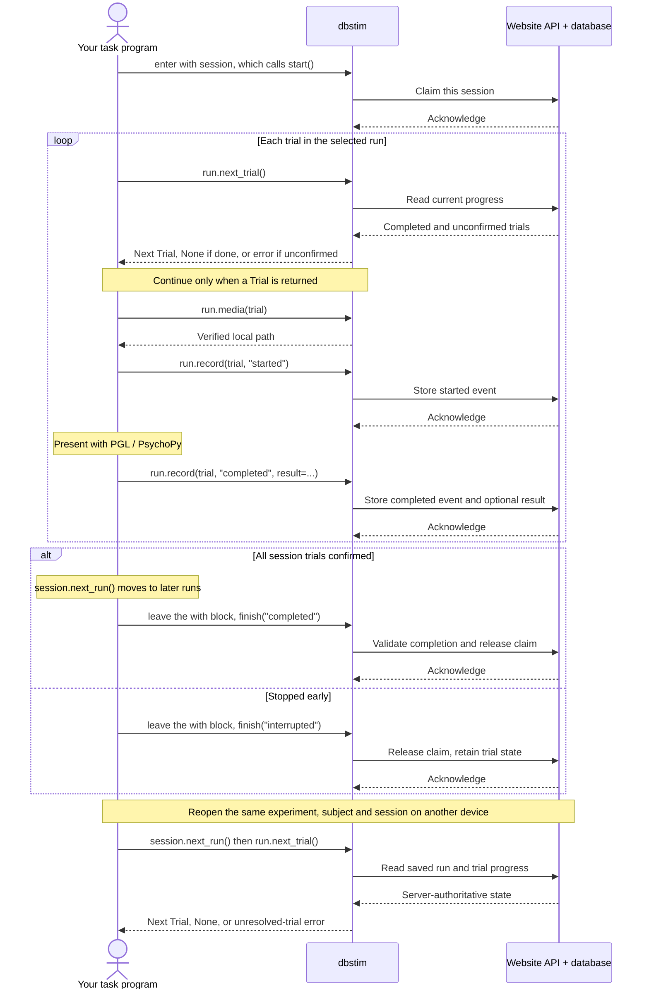

# From experiment to presentation

## 1. Assignments and media

Creation saves a filtered sample and design. Publishing freezes each subject's
trial order, runs, and source intervals. Loading a subject verifies the manifest
hash; downloading or previewing leaves presentation progress unchanged.

`session.download(directory)` fetches the session's media; `run.media(trial)`
fetches one item if it is not already verified locally. `mode="local"` requires
verified files in the session directory; pass that same `directory=` when reopening. Files are checked
against size, SHA-256, and assignment identity. `mode="remote"` returns a five-minute
streaming URL. Researchers authenticate to the website, not Google Cloud.

## 2. Record and resume

Your task explicitly reports each presentation. The server records acknowledgments;
it cannot infer that someone watched a clip from a download.

Completed trials stay completed. An unconfirmed start anywhere in the session
blocks every run until reviewed; recovery policy is not yet implemented. Retry
unacknowledged operations unchanged on the **same Session object**. An active
presenter requires explicit `start(takeover=True)` to replace. An error inside
`with session:` finishes it as `failed`.

`session.next_run()` is the next unfinished run; `session.run("latest")` is the
most recently started one. `run.results` reads reported results from the server. Deleting local downloads never resets server progress.

[API objects](api-classes.md) · [Metric storage and filters](metrics-and-filters.md)
